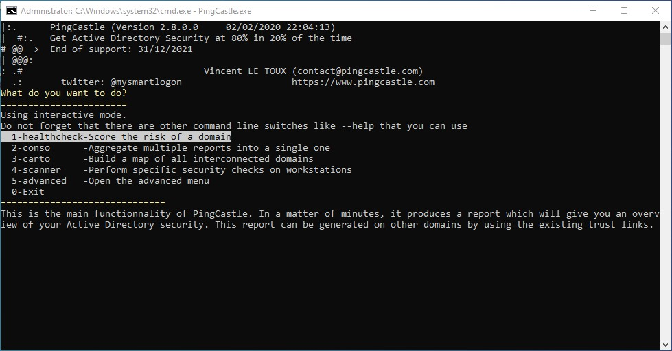
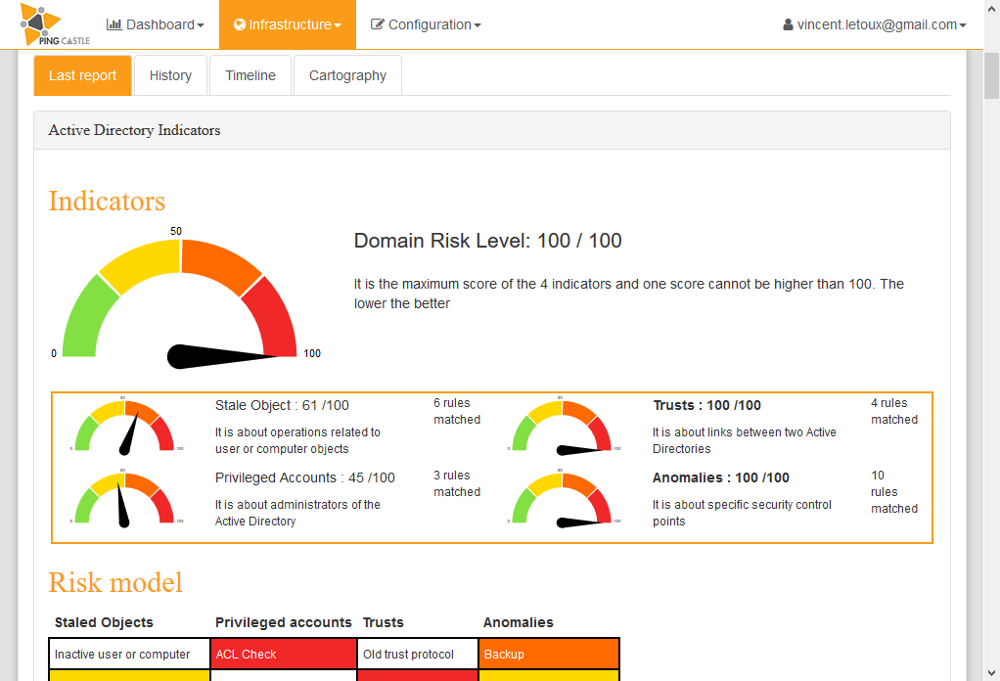

Key information 

| AD Users                          | Valid accounts for password spraying                                                                           |
| --------------------------------- | -------------------------------------------------------------------------------------------------------------- |
| **AD Joined Computers**           | **Key computers include Domain Controllers, file servers, SQL servers, web servers. Exchange mail servers...** |
| **Key Services**                  | **Kerberos, NetBIOS, LDAP, DNS**                                                                               |
| **Vulnerable Hosts and Services** | **Anything that can be a quick win**                                                                           |

Active Directory PowerShell module
```powershell
Get-Module
Import-Module ActivedDirectory
Get-ADDomain
```
# Automated
## Bloodhound
```bash
sudo neo4j console
bloodhound
```
Bloodhound ingestor
```bash
sudo bloodhound-python -d <DOMAIN> -u <USERNAME> -p <PASSWORD> -ns <DC IP> -c all
```
## LDAPDomainDump 
```bash
ldapdomaindump ldaps://<LDAP_SERVER> -u <DOMAIN\USERNAME> -p <PASSWORD>

ldapdomaindump ldaps://10.0.2.15 -u 'MARVEL\fcastle' -p Password1
```
## Plumhound
Plumhound will analyze information of Bloodhound and generate report.
```bash
# Neo4j console and Bloodhound must not be closed
sudo python3 PlumHound.py -x tasks/default.tasks -p <Neo4j PASSWORD>
```
The `index.html` file will contain all information.
## PingCastle
Active Directory audit scanner (ran to do checks on the system).


A report can be generated; domain risk scores is evaluated: state current risks and mitigation techniques.

# Manual 
## IP address enumeration
Wireshark

Responder

nxc
```bash
nxc smb 10.0.2.0/24 -d <DOMAIN>
```

(PowerView) Password Policy ([T1201](https://attack.mitre.org/techniques/T1201))
```powershell
GetDomainPolicy
```
(Ldapsearch + Cobalt Strike) DC naming 
```bash
ldapsearch -H ldap://<DC-IP> -x -s base namingcontexts
```
(Ldapsearch + Cobalt Strike) User account filter
```bash
ldapsearch -H ldap://<DC-IP> -x -b "DC=baby,DC=vl" (samAccountType=805306368)
```
(Ldapsearch + Cobalt Strike) Admin accounts
```bash
ldapsearch -H ldap://<DC-IP> -x -b "DC=baby,DC=vl" (&(samAccountType=805306368)(adminCount=1))
```
(Ldapsearch + Cobalt Strike) Unconstrained Delegations
```
ldapsearch (&(samAccountType=805306369)(userAccountControl:1.2.840.113556.1.4.803:=524288)) --attributes samaccountname
```
